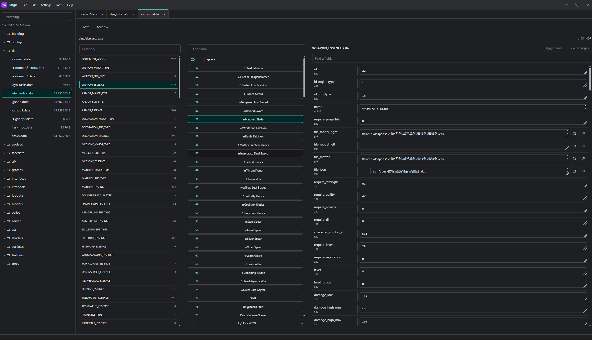
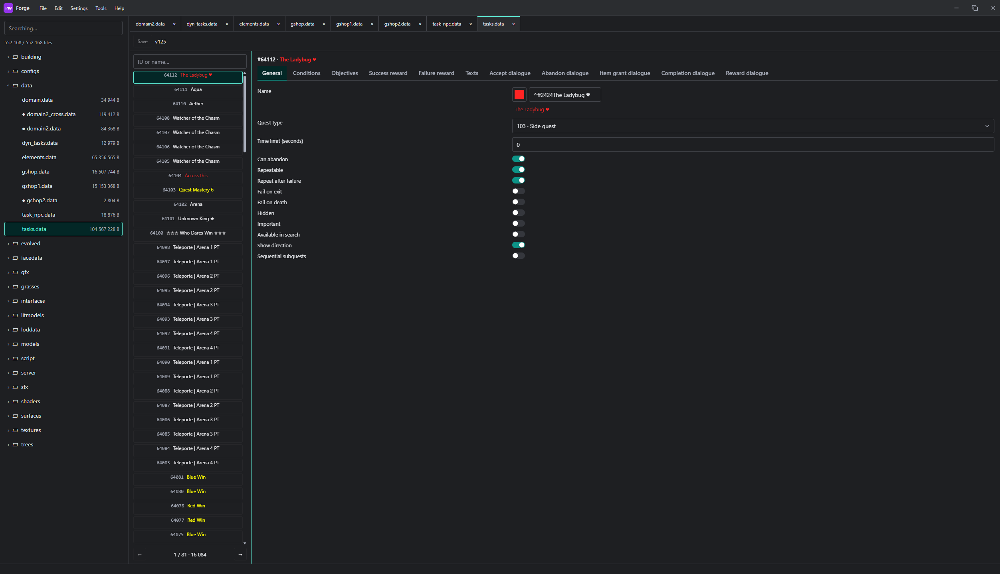
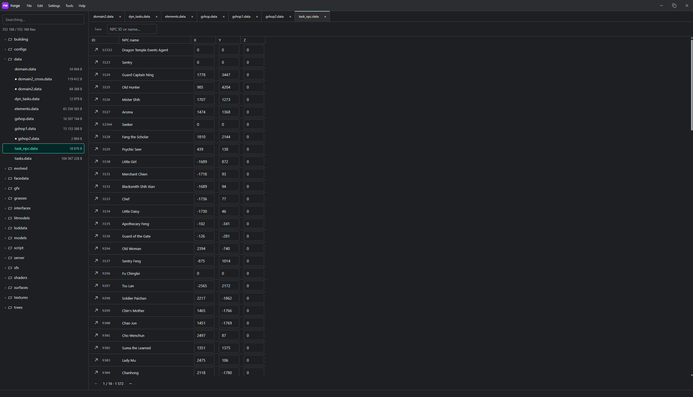
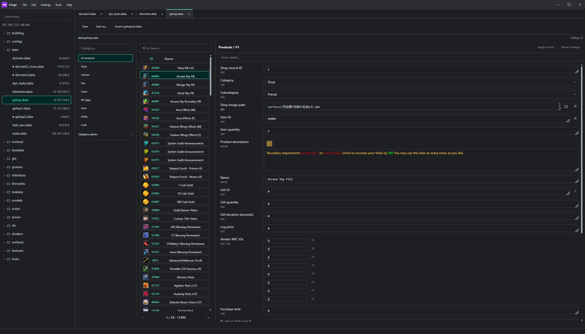
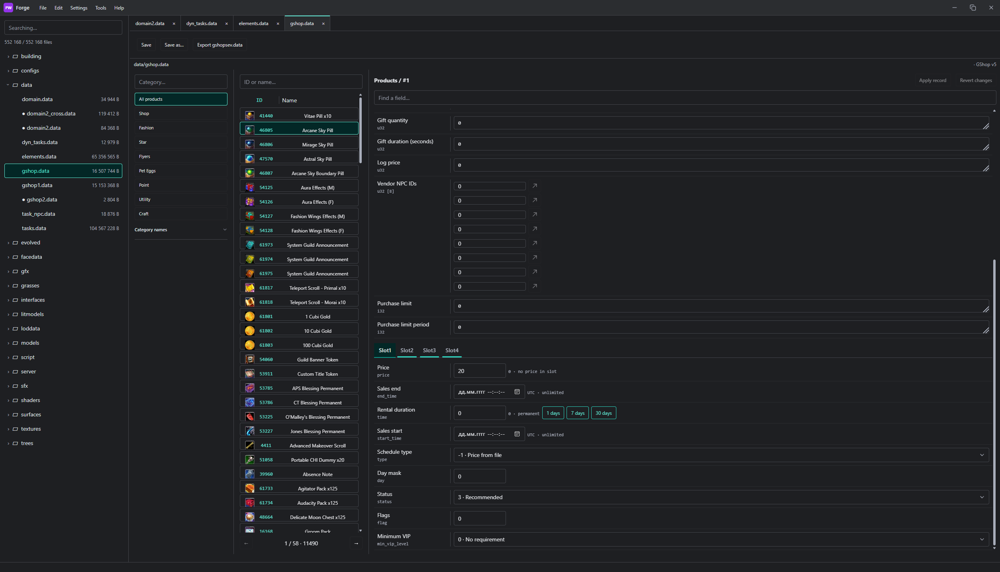
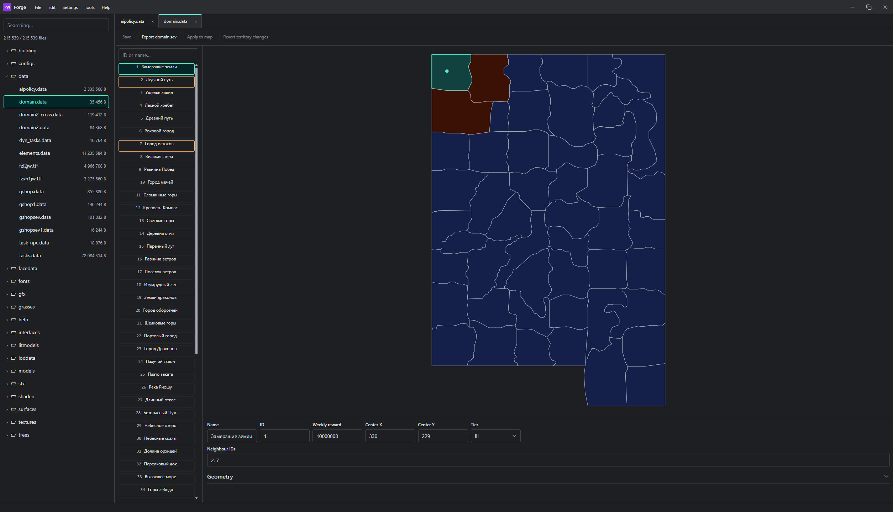
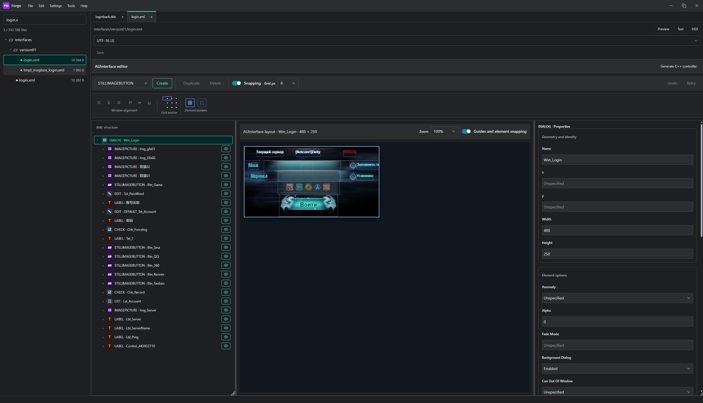
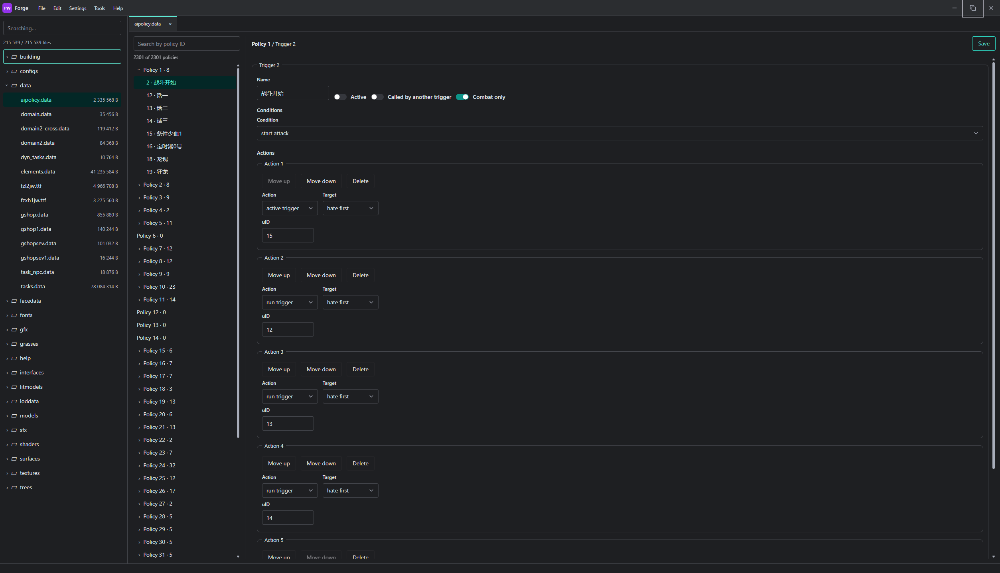

<div align="center">

[Русский](README.md) · **English**


# PW Forge

A Perfect World editor for Windows. Work with PCK archives, client files, and translations in one workspace.


[Working with projects](#working-with-projects) · [Project format](#project-format-on-disk) · [Editors](#editors-and-search) · [Previews](#previews-and-model-export) · [Translation](#translation) · [MCP](#local-mcp-server) · [Showcase](#showcase) · [Build](#installation-and-build)

</div>

---

## Showcase

| Elements editor                                                                     | Quest editor                                                                        | Quest NPCs                                                                                                                  |
|-------------------------------------------------------------------------------------|-------------------------------------------------------------------------------------|-----------------------------------------------------------------------------------------------------------------------------|
| [](assets/showcase/elements.png)    | [](assets/showcase/tasks.png)             | [](assets/showcase/task_npc.png)                                                 |
| **Cash shop**                                                                       | **Cash shop, second view**                                                          | **Territories**                                                                                                             |
| [](assets/showcase/gshop.png)                | [](assets/showcase/gshop2.png) | [](assets/showcase/domain.png)                                                    |
| **Interface editor**                                                                | **AI policy editor**                                                                | **Model preview (v155)**                                                                                                    |
| [](assets/showcase/ui_editor.png) | [](assets/showcase/ai-policy.png) | [](assets/showcase/model_preview%28v155only%29.png) |

## Working with projects

1. Click **Create project**, select the game client folder, and choose the archives to import.
2. PW Forge copies the `data` folder and the selected PCK/PKX archives into the project. Open the `.pwforge` manifest
   from the app or double-click it after registering the file association through **Associate .pwforge**.
3. Open resources from the tree on the left. They appear in tabs on the right. Archive entries are indexed, and
   resources are extracted into the cache when opened.
4. Saved edits live separately from the original files. A project build produces modified archives and loose files ready
   to copy into the client.

Use **Open** to work with an individual archive or client file outside a project.

### Import and build

- When creating a project, choose the archives, client version, and `elements.data` schema profile. Import server files separately from the **Tools** menu.
- In project mode, **Save** writes to the edit layer. For a standalone archive, use **Save PCK as…**.
- **Build full project** creates a complete project output. **Build changes** outputs the affected archives and modified loose files. Results appear in `builds/`. Use **Tools** to clean old builds.
- Settings include Russian and English, light, dark, and system themes, configurable keyboard shortcuts, and the number of build threads.

## Project format on disk

```text
MyProject/
  MyProject.pwforge
  originals/
    data/
    archives/
  edits/
    data/
    archives/<archive.pck>/<resource path>
  .forge/
    index/<archive.pck>.json.gz
    cache/
    backups/
  locales/
    source.json
    ru.json
  builds/<build ID>/
    pwforge-build.json
```

The JSON manifest contains `format: "pw-forge-project"` and `version: 2`. The `name`, `source`, `archives`, `status`,
and `errors` fields record the project name, source client folder, selected archives, import status, and import errors.
The importer skips `bug.pck`. Project paths resolve relative to the manifest directory.

Reads prefer the corresponding file in `edits/`. Otherwise, loose files are read from `originals/data/`, and archived
resources are extracted from PCK/PKX. The version 2 index stores each entry's name, offset, unpacked size, and packed
size. PW Forge reuses the saved index when the PCK and PKX metadata match. If an archive changes or its index is
missing, PW Forge reads the entry table again. Both `.forge/index/` and `.forge/cache/` can be regenerated from the
original copies.

A changes-only build groups saved edits by archive and produces the affected archives and modified loose files. The build
writes to a temporary directory first, then publishes the result under `builds/`. The `pwforge-build.json` report lists
the built archives and the number of loose files. Project builds can split archives into PCK and PKX when needed.

## Editors and search

| Format | Features |
| --- | --- |
| PCK / PKX | Resource tree, extraction, addition, replacement, deletion, and packing |
| `elements.data` | Categories, record search, typed fields, resource selection, and previews |
| `gshop.data`, `gshop1.data`, `gshop2.data` | Categories and subcategories, purchase slots, inventory icons, and links to related records |
| `domain.data`, `domain2.data`, `domain2_cross.data` | Map, territory list, and highlighting for neighboring territories |
| `tasks.data` | Quest tree, fields, rewards, text, dialogues, and existing subquests |
| `dyn_tasks.data`, `task_npc.data` | Editors for dynamic quests and quest NPC records |
| `aipolicy.data` | AI policy tree, conditions, and actions |
| `extra_drops.sev`, `npcgen.data`, `path.sev`, `wmgj.nmd` | Server records, section selection, lookup by record number or ID, and field editing |
| XML interfaces | Visual editor, element tree, and properties panel |
| `DCF`, `STF`, `HTF`, `DTF` | Window registry and editors for legacy interface formats |

The shop and quest editors link to related item and NPC records when the corresponding `elements.data` is available in the project. Export `world_targets.txt` and `serverlist.txt` as binary `world_targets.sev` and `serverlist.sev` files.

### elements.data versions

PW Forge detects the version from the file header and selects a schema from the catalog. Project settings let you choose the version and schema variant manually. The editor offers 94 profiles covering 90 versions, including a dedicated LRPW profile for v145.

```text
6–7, 10, 12–15, 17–18, 20, 22, 24–25, 27, 29–33, 52–56,
60–63, 65–70, 73, 76–77, 80–81, 84–85, 87–88, 99–102,
104–106, 108, 112–115, 118, 120–125, 127–137, 144–145,
153–157, 159, 161–162, 164–165, 167–170, 181
```

### tasks.data versions

The editor detects the version from the file header and displays it when the file opens. Schemas cover 108 format versions.

```text
43, 52–57, 59–60, 63–64, 68–69, 75, 78–130,
135, 137, 139–140, 146–147, 153, 156–158, 161–164, 167,
175–178, 180–183, 185–195, 198, 215–220
```

Fields that control record layout are protected from direct edits. Subquest editing works within the existing tree. Synthetic files verify reading and saving for the ported schemas. Real-file validation covers a subset of versions. The schema was adapted from MyAceEditor under [GPL-3.0](src-tauri/src/task_schema_generated.LICENSE).

### Other format versions

| Format | Supported versions and variants |
| --- | --- |
| `gshop.data`, `gshop1.data`, `gshop2.data` | Layouts v0–v7. Automatic detection selects v6 for the shared v6/v7 layout. `gshop2.data` also supports a v5 variant with trailing data |
| `dyn_tasks.data`, `task_npc.data` | v10 and v1, respectively |
| `aipolicy.data` | File and policy records v1, triggers v0–v23 |
| `extra_drops.sev` | v1 |
| `npcgen.data` | v0–v11 |
| `path.sev` | v0–v1 |
| `wmgj.nmd` | NMD v1 |


### Interface editing

- In the XML editor, select elements on the canvas or in the tree, edit sizes and properties, reorder elements, or change their parent. Flex containers support direction, alignment, and sizing to content.
- The preview uses available game textures and fonts. Text mode opens the source XML.
- In DCF, add or delete window entries, change coordinates and startup visibility, and open the linked XML. The editor flags duplicates and missing XML files.
- STF, HTF, and DTF have dedicated editors. DTF also offers a visual mode.

### Content search

Search opens in a separate window that you can move to a second monitor. Scope a search to the entire project, a PCK or data module, or a folder. Search supports file masks, regular expressions, case sensitivity, and whole-word matching. Canceling preserves the matches already found.

## Previews and model export

- General resource tools include image previews, DDS/TGA decoding, audio and video playback, and text and hex views.
- The native Angelica component plays supported `.gfx` effects and displays `.mox`, `.ecm`, `.smd`, and `.ski` models and `.bon` skeletons. Orbit and zoom the model camera, or pause and restart animation.
- ECM and SMD let you select actions declared in the model. SKI requires a BON file with the same base name. Native preview reads the original archives from disk and relies on the available texture, configuration, and shader archives.
- GLB export saves MOX geometry. Supported ECM, SMD, and SKI exports also include the skeleton, weights, declared animations, and diffuse textures. Morph targets, cloth, and game shaders are outside the export scope. See the [native component documentation](native-gfx/README.md) for details and limits.


The animation picker uses tracks declared in the model. Binding an arbitrary external STCK is unsupported. GFX compatibility depends on client version and assets. MCP interface PNG capture uses a separate renderer and excludes native GFX.

## Translation

Text export creates `locales/source.json`. Each entry records the file path, field path, and individual text segments
with their colors. Translations are stored in the selected locale file, such as `locales/ru.json`.

- Search within the translation editor, filter for untranslated entries, and translate them manually or in batches.
- Supported providers include DeepL, Yandex Translate, Ollama, and OpenAI-compatible APIs. API keys are stored in
  Windows Credential Manager.
- Batch translation shows saved results as it runs and supports cancellation and resumption. Existing translations are
  preserved. Changes to placeholders and formatting codes are flagged for manual review.
- **Apply translation** writes translated resources through the project's edit layer, preserving colors and original
  files.

### JSON structure

The source catalog contains an `entries` array. A translation file also contains `version` and `language`. In each
entry, `file` identifies the virtual file path, `path` identifies the field within the resource, and `segments` holds
fragments with `text` and `color`. Colors are stored as six-digit RGB hex values without a prefix, or as `null`. A
translation entry can also contain `source_segments` for comparison with the original text.

Completed batch results are written to a `<language>.pending.jsonl` journal. On completion or the next batch run, PW
Forge merges the journal into the locale JSON and fills empty segments. Applying a translation checks the source
segments and field paths and reports errors per file.

## Local MCP server

Run `pwforge.exe --mcp` as a local stdio server. An MCP client can open a `.pwforge` project, create a project from client files, or work with a standalone PCK. Standalone archive mode requires a path for a new output file.

- For interfaces, the server can find XML files, inspect element trees, patch coordinates and sizes against a revision, and capture PNG previews. Capture requires Node.js 22+ and Chrome or Edge.
- For game data, the server can inspect and replace files, apply supported structured edits, export a text catalog, and save translations back to the project.
- In project mode, saving writes to the same edit layer used by the desktop editor. Building produces a new archive or a project build output.

See [MCP.md](MCP.md) for configuration examples and tool parameters.

## Application architecture

- `src/app/IdeApp.tsx` manages the resource tree, tabs, and resource opening.
- `src/features/editor/` contains the editors. `src/features/search/` contains the separate search window.
- `src-tauri/src/project.rs` handles imports, indexes, the edit layer, and project builds. `ide.rs` handles resource
  access and standalone files.
- `src-tauri/src/locales.rs`, `locale_batch.rs`, and `translation.rs` handle locale files, batch processing, and
  requests to translation providers.
- `native-gfx/` contains a separate executable. Tauri starts it for native previews and communicates with it through the
  backend.

## Installation and build

Extract the ZIP from [Releases](https://github.com/LRPW/pw-forge/releases) into a dedicated folder and run `pwforge.exe`
alongside `native-gfx.exe` and the DLLs. The app requires the WebView2 Runtime.

Building requires Node.js, Yarn Classic, Rust with MSVC, Visual Studio with x86 C++ tools, the Windows SDK, and the
DirectX SDK (June 2010). Native GFX also uses engine sources and libraries from the client source tree.
See [native-gfx/README.md](native-gfx/README.md).

Run these commands from the directory containing `package.json`:

```powershell
yarn install --frozen-lockfile
npm run tauri dev
```

Run `npm run tauri:build` to produce a portable ZIP, NSIS installer, installer signature and `latest.json` under
`release/`. Tauri builds Native GFX automatically.

Upload those files to a GitHub Release tagged `v<version from package.json>`. The installed app updates through Help →
Check for updates. The portable build opens the release page for the ZIP download.

Local builds create `.release-signing/update.key`. Use the same signing key for later releases. On a build server,
provide `TAURI_SIGNING_PRIVATE_KEY` and its public key as `PW_FORGE_UPDATE_PUBLIC_KEY`. Set
`TAURI_SIGNING_PRIVATE_KEY_PASSWORD` when the key is password protected.

```powershell
npm test
cargo test --manifest-path src-tauri/Cargo.toml
```

For integration tests that use real game files, set `PW_CLIENT_DIR` to the installed client folder and run the relevant
test with `-- --ignored`.

## PCK limits

PW Forge supports archive format `0x20002`, including split PCK/PKX archives. The desktop editor saves a standalone archive as one PCK smaller than `0x7fffff00` bytes. Project builds and standalone MCP archive builds support PCK/PKX splitting. Encrypted archives can be read, extracted, and rebuilt in project mode. Standalone archive rewriting is unavailable for encrypted archives.

Content search returns up to 5,000 matches and skips files larger than 256 MiB. The 256 MiB per-file limit also applies to reading resources in the editor and packing replacements. Media playback depends on the codecs available to WebView2.
